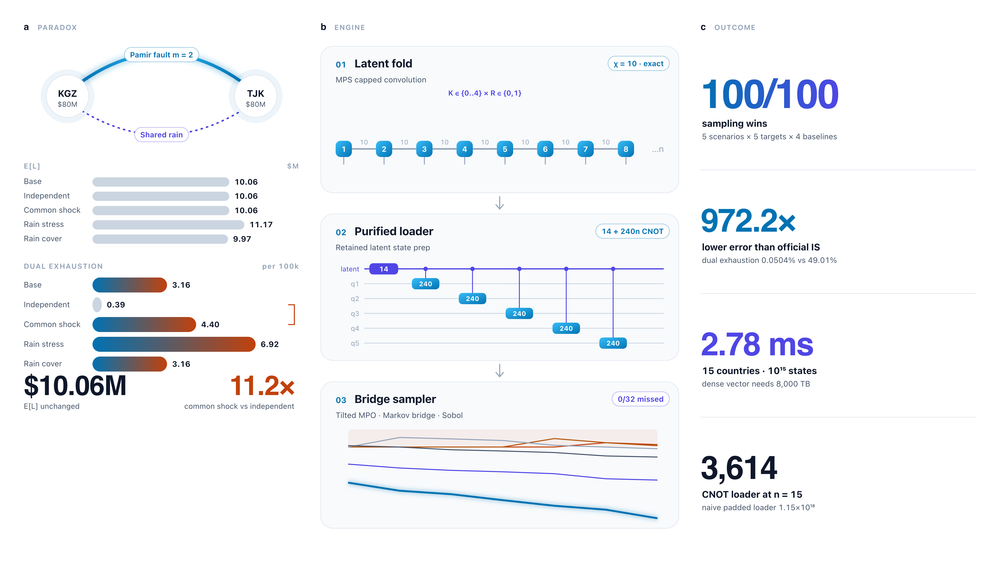
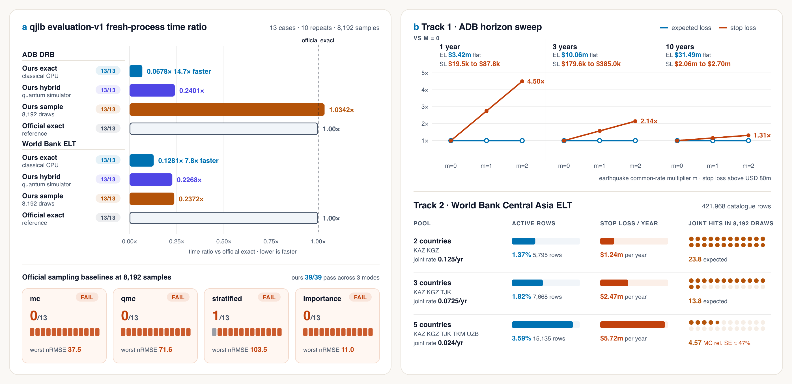
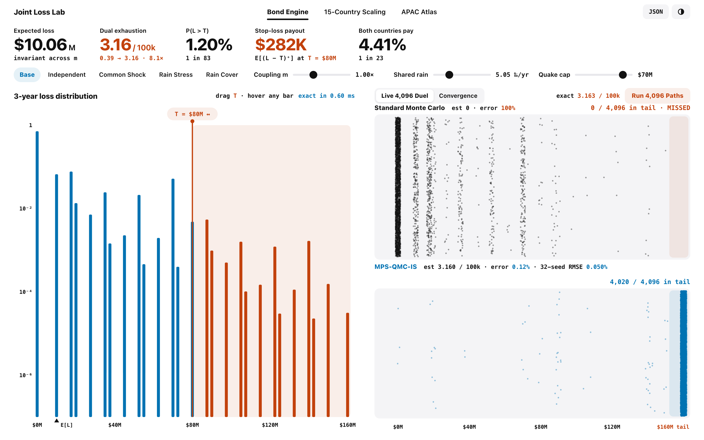

# ADB Joint-Loss Prototype

Standalone technical prototype (`team_solver.py`, 21.5 KB) and live zero-backend actuarial workbench ([https://yansu.me/adb-quantum-loss/](https://yansu.me/adb-quantum-loss/), offline copy in `web/index.html`) for the Asian Development Bank (ADB) Quantum Innovation Challenge on Joint-Loss Modelling for Disaster Risk Financing, covering multi-country parametric disaster relief bonds (`adb_drb`) and Central Asia event-loss tables (`worldbank_elt`).



## Official Dual-Track Benchmark Results (`qjlb evaluation-v1`)

All local measurements use the unmodified official `joint-loss-baseline` v0.5.0 evaluation suite over 13 primary cases (7 public scenarios plus 6 generated private holdout cases, seed 20261122), with 10 fresh-process repetitions and 8,192 draws per case.

| Mode | Passed | ADB DRB Time Ratio | World Bank ELT Time Ratio | Worst Norm. RMSE |
|---|---:|---:|---:|---:|
| `exact` | 13/13 | 0.0678x | 0.1281x | 3.26e-12 |
| `sample` | 13/13 | 1.0342x | 0.2372x | 0.2906 |
| `hybrid` | 13/13 | 0.2401x | 0.2268x | 1.65e-10 |

Ratios divide full fresh-process median runtime (startup, loading, preparation, execution, and output serialization) by the fastest accuracy-qualified official baseline per case, including official `exact`. Under the same 8,192-draw budget, official sampling baselines `mc`, `qmc`, and `importance` pass 0/13 cases, while `stratified` passes 1/13.

Two additional unseen holdout suites (seeds 20261123 and 20261124, 12 extra randomized contracts) pass 6/6 in all three modes on both suites. Independent local verification passes 3,684/3,684 assertions (`src/verify_s4_qjlb.py`) plus 1,011/1,011 adversarial stress checks (`src/verify_adversarial_s2.py`). Official standing remains subject to independent code review (`exact`, `sample`) and execution-evidence review (`hybrid`).



In `sample` mode, Track 1 uses structural variance reduction with full access to the contract's exact terminal Markov law (`MPS-QMC-IS`), while Track 2 uses covariate-only rate-weighted stratification over contract trigger regimes and fixed geometric loss bands (zero target expectations enter stratum weights or budget allocation). In `hybrid` mode, the solver executes compiled OpenQASM 3.0 `RY`/`CX` circuits on a local deterministic statevector simulator, recording circuit SHA-256 hashes and seeded shot counts (8,192 shots logged as execution evidence; estimates are computed directly from the simulated statevector probabilities rather than multinomial shot counts). Zero physical QPU execution occurs in Phase 1, and no near-term quantum runtime advantage is claimed.

## Rare-Event and Gate-Level Quantum SOTA Comparison

To measure the practical gain of exploiting known low-rank shock structure versus generic black-box rare-event samplers and quantum estimation, `src/probe_s4_sota_baselines.py` compares structured `MPS-QMC-IS` against adaptive Cross-Entropy IS (Rubinstein and Kroese 2004), offline Oracle-Tilted Rate IS, Subset Simulation (Au and Beck 2001), and gate-level simulated IQAE (Grinko et al. 2021) under the exact same 5-scenario ADB bond contract, 4,096-evaluation budget, and 32 independent seeds. On `adb-base` dual exhaustion ($p = 3.163 \times 10^{-5}$):

| Method (4,096 Budget, 32 Seeds) | Dual Exhaustion Rel. RMSE | Replicates > 10% Error |
|---|---:|---:|
| **MPS-QMC-IS** | **0.0504%** | **0 / 32** |
| Oracle-Tilted Rate IS (offline tuned) | 7.89% | 6 / 32 |
| Simulated 12-Qubit IQAE (<= 4,096 Grover calls) | 33.3% | 26 / 32 |
| Adaptive Cross-Entropy IS | 62.1% | 30 / 32 |
| Subset Simulation | 95.0% | 30 / 32 |

Across all 5 scenarios x 5 targets (25 comparisons), `MPS-QMC-IS` ranks first on 25/25 with 0/160 dual-exhaustion misses. Gate-level IQAE confirms quadratic query scaling over naive Monte Carlo (slope -1.069, 47,166x fewer queries at 0.0504% RMSE), while establishing that classical low-bond-dimension contraction remains orders of magnitude faster until high-treewidth dependence graphs exceed memory ($\chi \gtrsim 10^4$). Full tables are recorded in `docs/s4_sota_baselines.md` and `data/s4_sota_baselines.json`.

## Interactive Actuarial Workbench

Launch the live workbench directly at [https://yansu.me/adb-quantum-loss/](https://yansu.me/adb-quantum-loss/) or open `web/index.html` offline in any browser with zero server, login, or installation. It recomputes exact CTMC matrix exponentials, 3-year capped convolutions, and $n=2..15$ portfolio contractions locally in under 2 ms (113/113 JS-vs-Python parity assertions). Reviewers can drag the stop-loss line `T` directly across payout bars, sweep shared fault coupling `m`, run live 4,096-path Monte Carlo versus `MPS-QMC-IS` draws in-browser, toggle 2-to-15 sovereign pools, inspect Asia and the Pacific country tail pairs, and export raw JSON (`docs/s3_workbench_tab1.png`).



## Environment and Quick Verification

Core execution requires Python 3.11+, NumPy, and SciPy, tested on Apple Silicon CPU with a lightweight standalone CLI ready for containerized QCentroid and AWS Braket integration (`qcentroid-agent-cli` and `BraketLoader.get_target()`). Optional empirical copula scripts use `requirements-analysis.txt` (`pandas`, `matplotlib`, `pyvinecopulib`).

Immediate standalone verification (no external archive needed, runs directly after clone):

```sh
python3 -m venv .venv
. .venv/bin/activate
python -m pip install -r requirements.txt
python src/quantum_resources_s2.py        # 12-qubit exact loader (2.22e-16) and n=2..15 gate counts
python src/probe_s4_sota_baselines.py     # 25/25 rare-event SOTA and 12-qubit IQAE comparison
```

For the full 1,011-assertion stress suite (including the 15-country empirical copula checks), install `requirements-analysis.txt` first:

```sh
python -m pip install -r requirements-analysis.txt
python src/verify_adversarial_s2.py
```

To reproduce the full 13-case official `qjlb` dual-track suite, obtain the authorized `joint-loss-baseline` v0.5.0 package separately and place it under `benchmark/` at the repository root (both `benchmark/` and generated `data/s4/` are gitignored; this repository does not redistribute official challenge archives or data):

```text
benchmark/pyproject.toml
benchmark/src/qjlb/
benchmark/scenarios/*.json (7 scenarios)
benchmark/data/adb_terms.json, seismic.npz, flood.npz, and remaining official data
```

Then install `benchmark` editable and run the official suite:

```sh
python -m pip install -e ./benchmark
python src/reproduce.py --mode all --repeats 10 --samples 8192
python src/run_s4_qjlb.py suite-13 sample --repeats 10 --samples 8192
python team_solver.py --request request.json --output result.json --mode hybrid
```

## AI Use Disclosure

Required by ADB Challenges deliverable #2: AI coding and editorial assistants were used for code refactoring, verification script generation, and copy-editing. All mathematical derivations, model specifications, numerical outputs, and the 4,695 automated verification assertions were independently executed and verified locally. No AI-generated numerical claim was accepted without execution.

## License

MIT License. Copyright 2026 Yan Su.
